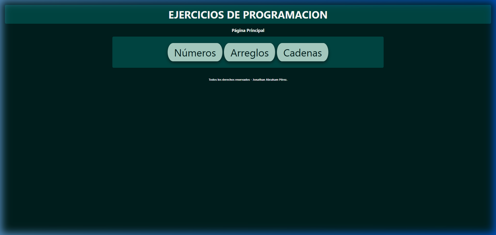
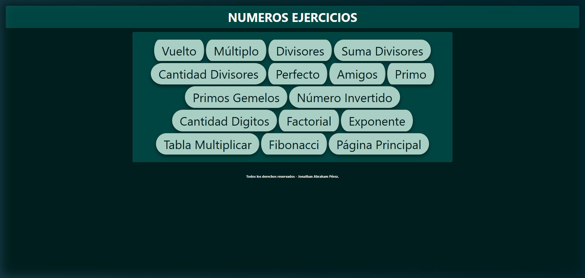
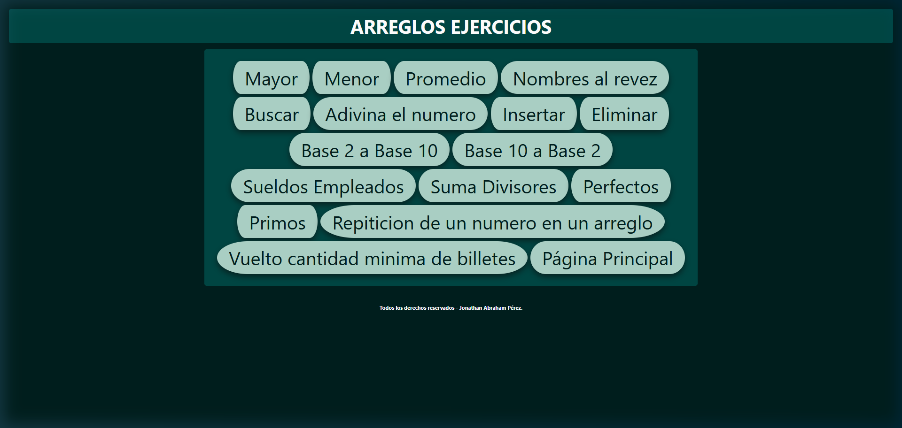
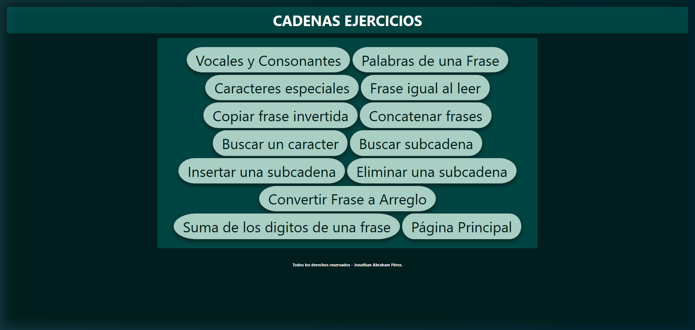
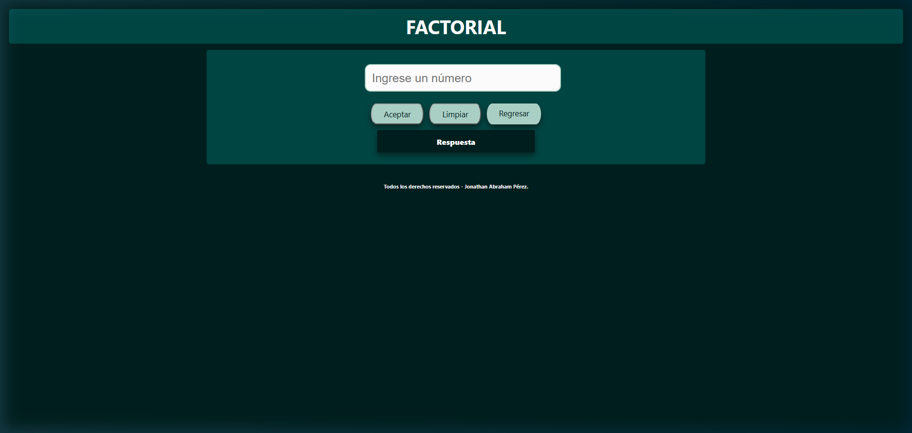

# 🧮 MatHub — Ejercicios de Programación

Página web interactiva para practicar ejercicios de programación en tres categorías: **Números**, **Arreglos** y **Cadenas**. Cada ejercicio funciona directamente en el navegador sin necesidad de instalar nada.

---

## 🖼️ Capturas de pantalla

### Página Principal


### Ejercicios de Números


### Ejercicios de Arreglos


### Ejercicios de Cadenas


### Vista de un Ejercicio


---

## 📁 Estructura del proyecto

```
Pagina-Ejercicios-Cadenas-Arreglos-Numeros/
├── index.html                  # Página principal
├── Css/
│   └── estilo.css              # Estilos globales
├── JavaScript/
│   └── index.js                # Lógica principal
├── Imagenes/                   # Recursos gráficos
└── Html/
    ├── numeros.html            # Menú de ejercicios numéricos
    ├── arreglos.html           # Menú de ejercicios de arreglos
    ├── cadenas.html            # Menú de ejercicios de cadenas
    ├── numerosEjercicios.js/   # Páginas de ejercicios numéricos
    ├── arreglos_ejercicios/    # Páginas de ejercicios de arreglos
    └── cadenas_ejercicios/     # Páginas de ejercicios de cadenas
```

---

## 📚 Ejercicios disponibles

### 🔢 Números (15 ejercicios)

| Ejercicio | Descripción |
|---|---|
| Vuelto | Calcula el vuelto de una compra |
| Múltiplo | Determina si un número es múltiplo de otro |
| Divisores | Lista los divisores de un número |
| Suma Divisores | Suma todos los divisores de un número |
| Cantidad Divisores | Cuenta cuántos divisores tiene un número |
| Perfecto | Verifica si un número es perfecto |
| Amigos | Verifica si dos números son amigos |
| Primo | Verifica si un número es primo |
| Primos Gemelos | Encuentra pares de primos gemelos |
| Número Invertido | Invierte los dígitos de un número |
| Cantidad Dígitos | Cuenta los dígitos de un número |
| Factorial | Calcula el factorial de un número |
| Exponente | Calcula una potencia sin usar Math.pow |
| Tabla Multiplicar | Muestra la tabla de multiplicar |
| Fibonacci | Genera la secuencia de Fibonacci |

### 📦 Arreglos (16 ejercicios)

| Ejercicio | Descripción |
|---|---|
| Mayor | Encuentra el elemento mayor de un arreglo |
| Menor | Encuentra el elemento menor de un arreglo |
| Promedio | Calcula el promedio de los elementos |
| Nombres al revés | Invierte cada nombre en un arreglo |
| Buscar | Busca un elemento y retorna su posición |
| Adivina el número | Adivina un número generado aleatoriamente |
| Insertar | Inserta un elemento en una posición dada |
| Eliminar | Elimina un elemento del arreglo |
| Base 2 a Base 10 | Convierte un número binario a decimal |
| Base 10 a Base 2 | Convierte un número decimal a binario |
| Sueldos Empleados | Calcula el promedio de sueldos |
| Suma Divisores | Suma divisores de cada elemento del arreglo |
| Perfectos | Indica cuáles elementos son números perfectos |
| Primos | Indica cuántos elementos son números primos |
| Repetición de un número | Cuenta cuántas veces se repite un número |
| Vuelto cantidad mínima de billetes | Devuelve el vuelto con la menor cantidad de billetes |

### 🔤 Cadenas (12 ejercicios)

| Ejercicio | Descripción |
|---|---|
| Vocales y Consonantes | Cuenta vocales y consonantes de una frase |
| Palabras de una Frase | Cuenta las palabras de una frase |
| Caracteres Especiales | Cuenta , . ; : en una frase |
| Frase igual al leer | Verifica si una frase es palíndromo |
| Copiar frase invertida | Invierte una frase |
| Concatenar frases | Une dos frases en una tercera |
| Buscar un carácter | Retorna la posición de un carácter |
| Buscar subcadena | Retorna la posición de una subcadena |
| Insertar una subcadena | Inserta una subcadena en una posición dada |
| Eliminar una subcadena | Elimina una subcadena de una frase |
| Convertir Frase a Arreglo | Divide una frase en un arreglo usando separador |
| Suma de los dígitos de una frase | Suma los dígitos numéricos presentes en una frase |

---

## 🚀 Cómo ejecutar

1. Clona el repositorio:
   ```bash
   git clone https://github.com/JAPREZ/Pagina-Ejercicios-Cadenas-Arreglos-Numeros.git
   ```
2. Accede a la carpeta del proyecto:
   ```bash
   cd Pagina-Ejercicios-Cadenas-Arreglos-Numeros
   ```
3. Sirve el proyecto con un servidor local (por ejemplo, con PHP):
   ```bash
   php -S localhost:8000
   ```
4. Abre tu navegador en http://localhost:8000

> ⚠️ Los ejercicios usan rutas absolutas (/Html/...), por lo que **es necesario un servidor local** para que funcionen correctamente.

---

## 🛠️ Tecnologías utilizadas

- **HTML5** — Estructura de las páginas
- **CSS3** — Estilos y diseño visual
- **JavaScript (Vanilla)** — Lógica de cada ejercicio

---

## 👤 Autor

**Jonathan Abraham Pérez**
Todos los derechos reservados.
